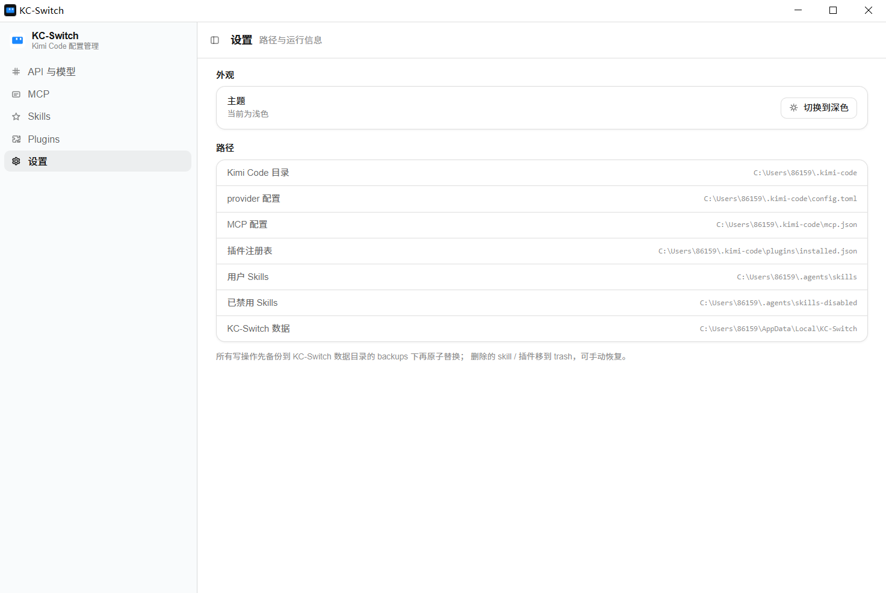
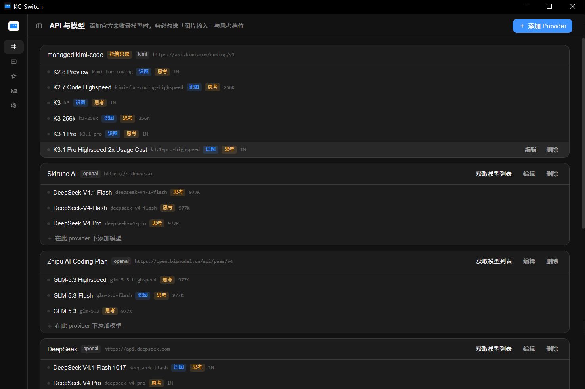

# KC-Switch

Kimi Code（CLI 与 Desktop 共用同一套配置）的**图形化配置编辑器**。

它解决的是一个很具体的问题：**给 Kimi Code 添加它没收录、或收录了但参数不全的模型时，只能手改 `config.toml`**。而那个文件里，`capabilities`、`support_efforts` 这类字段漏一个，就会出现"图片不能识别""思考强度切不了"这类莫名其妙的现象——你得反复翻文档、对照别的模型条目，才能补对。

KC-Switch 把这些字段做成表单，你勾选就行。



<sub>浅色主题下的「API 与模型」页。模型名右侧的「识图 / 思考」徽章是它在配置里声明的能力，点 `编辑` 可改全部字段。</sub>



<sub>深色主题。侧栏可收起为纯图标，折叠按钮固定在标题栏左侧。</sub>

---

## 目录

- [它不是做什么的](#它不是做什么的)
- [为什么要做这个](#为什么要做这个)
- [功能](#功能)
- [获取模型列表是怎么工作的](#获取模型列表是怎么工作的)
- [它改了哪些文件](#它改了哪些文件)
- [安全设计](#安全设计)
- [技术栈与架构](#技术栈与架构)
- [开发](#开发)
- [测试](#测试)
- [关于开发者的使用环境](#关于开发者的使用环境)
- [已知限制](#已知限制)
- [反馈](#反馈)
- [许可](#许可)

---

## 它不是做什么的

**不是模型切换器。**

切换 `default_model` 这件事，Kimi Code 里本来就能做，一点不麻烦。KC-Switch 也提供了切换入口，但那是顺手带的，不是重点，也不会围绕它做优化。

**不是 API 网关。**

不做本地代理、不做请求路由、不做熔断和故障转移。它只在配置文件的层面工作：你想加什么、改什么，它帮你把字段写对。

**不是 Kimi Code 的替代品。**

它不接管 Kimi Code 的安装、升级和运行。改完配置，重启 Kimi Code 生效。

---

## 为什么要做这个

Kimi Code 的模型能力全部声明在 `~/.kimi-code/config.toml` 里：

```toml
[models."zhipu/glm-4.6v"]
provider = "zhipu"
model = "glm-4.6v"
display_name = "GLM-4.6V"
max_context_size = 131072
capabilities = [ "image_in", "thinking", "tool_use" ]   # ← 少写 image_in，图片就识别不了
support_efforts = [ "low", "high", "max" ]              # ← 少写这个，思考强度调不动
default_effort = "high"
```

问题在于：

- **官方未收录的模型**，你得自己查它支持什么，然后手写进去。
- **即使是官方收录的模型，参数也可能不全**，比如某些智谱模型的视觉能力没被标出来，实际能识图却调不动。
- 字段名和取值范围没有强校验，写错了不会报错，只会"功能不生效"——排查起来很绕。

直接改 TOML 当然可以，但每次加个模型都去翻文件、对照着抄一遍字段、还要小心别破坏格式和注释，**很烦，而且不优雅**。

所以做了这个工具。目标很明确：**在一个直观的界面里，把模型、MCP、Skills、插件加进去、改对**。

---

## 功能

### API 与模型

**Provider 管理**

- 添加、编辑、删除 Provider：名称、Base URL、API Key、接口类型
- 修改名称时自动同步其下所有模型的 `provider` 字段
- `managed:` 前缀（Kimi Code 托管的登录态供应商）自动标记为只读，避免破坏登录

**模型全字段编辑**（核心）

每个字段都有对应的表单控件，不用记字段名：

| 字段 | 界面形态 | 作用 |
|---|---|---|
| `capabilities` | 6 个带说明的勾选框 | 图片输入、视频输入、思考、始终思考、工具调用、动态加载工具 |
| `support_efforts` | 低/中/高/最高 多选按钮 | 决定思考强度能选哪些档 |
| `default_effort` | 下拉框（只列已选档位） | 默认用哪一档 |
| `max_context_size` | 输入框 + 128K/200K/256K/1M 快捷键 | 上下文窗口 |
| `max_output_size` | 输入框 | 单次最大输出 |
| `adaptive_thinking` | 三态选择（开/关/不设） | 自适应思考 |
| `reasoning_key` | 输入框 | 少数供应商需要的推理字段名 |
| `display_name` / `id` / `model` | 输入框 | 显示名与配置键；ID 会自动拼成 `provider/model` |

**实时配置检查**

保存前后都会提示常见坑，不影响保存，但能让你知道哪里可能不生效：

- 模型名看起来支持视觉（`vl`、`vision`、`4o`、结尾 `v` 等），但没勾 `image_in`
- 勾了 `always_thinking` 却没勾 `thinking`
- 填了 `default_effort` 但 `support_efforts` 为空
- `default_effort` 的值不在 `support_efforts` 列表里（这条是 error 级）
- 没填 `max_context_size`
- 模型 ID 不以 `/model名` 结尾
- `capabilities` / `support_efforts` 里出现未知取值

**一键获取模型列表**

点一下按钮，从供应商的 `/models` 接口拉取全部模型，并自动补全参数——详见[下一节](#获取模型列表是怎么工作的)。

---

### MCP

- 增删改，表单区分 **stdio**（命令 + 参数 + 环境变量）和 **http**（URL + Bearer 环境变量名 + 额外请求头）
- **延迟加载（`deferred`）**开关：让不常用的 MCP 服务器在 Kimi Code 启动时不拉起，减少启动开销
- 环境变量只存变量名，不存令牌值

---

### Skills

- 扫描三类来源：用户级 `~/.agents/skills`、项目级 `<project>/.agents/skills`、插件内置
- 搜索与按来源筛选（Skills 数量很容易上百，没有搜索没法用）
- 启用/禁用：**移动目录**到同级的 `skills-disabled`，可随时恢复，不污染文件内容
- 插件内置的标记为只读

---

### Plugins

- 读取 `installed.json`，展示来源、版本/分支、启用状态
- 启用/禁用（改 `enabled` 字段）
- 删除：目录移入回收站 + 移除注册条目（二次确认）

---

### 界面

- 浅色 / 深色主题，跟随系统或手动切换，设置页内切换
- 侧栏可收起为纯图标模式，折叠按钮固定在标题栏左侧
- 视觉风格对齐 Kimi Code Desktop（令牌详见 [`DESIGN.md`](DESIGN.md)）

---

## 获取模型列表是怎么工作的

各家供应商的 `/models` 接口返回的信息差异极大，所以做了两层：

```
点「获取模型列表」
   ↓
① GET {base_url}/models        （带该 provider 的 API Key）
   ↓
② 按 base_url 在 models.dev 公共目录（232 个供应商）中匹配供应商
   ↓  补全接口没给的字段
③ 生成可编辑的模型条目 → 勾选 → 批量导入
```

**实测各家差异**：

| 供应商 | 接口直接返回 | 补全后 |
|---|---|---|
| DeepSeek | 上下文、输出、模态、推理档位 | 完整，含 `reasoning_key` |
| BeichenAPI | 上下文、输出、模态、推理档位 | 完整 |
| 智谱 | **只有 model id，参数全无** | 17 个模型全部拿到上下文；识别出 6 个视觉模型 |
| 自建中转 | 取决于中转实现 | 目录无匹配时只用接口信息，界面标「无参数」提醒手补 |

补全的字段来自 [models.dev](https://models.dev) 的 `limit.context`、`limit.output`、`modalities`、`reasoning_options`、`interleaved.field`。目录缓存在本地，7 天过期，可手动刷新。

**导入前可以先「编辑」**，在表单里调完再存。

---

## 它改了哪些文件

KC-Switch 只碰下面这几处，都是 Kimi Code 自己的配置：

| 内容 | 路径 | 操作 |
|---|---|---|
| Provider / 模型 | `~/.kimi-code/config.toml` | 读写 `[providers.*]`、`[models.*]`、`default_model` |
| MCP | `~/.kimi-code/mcp.json` | 读写 `mcpServers` |
| 插件 | `~/.kimi-code/plugins/installed.json` | 读写 `enabled`、删除注册 |
| Skills | `~/.agents/skills/` | 目录移动（启停）、移动回收站 |
| 自身数据 | 见「数据目录」 | 备份、回收站、目录缓存、界面偏好 |

**数据目录**优先级：

1. 环境变量 `KC_SWITCH_DATA_DIR`
2. Windows：`%LOCALAPPDATA%\KC-Switch`
3. Linux/macOS：`$XDG_DATA_HOME/KC-Switch` 或 `~/.local/share/KC-Switch`

kimi 配置目录可用 `KIMI_CODE_HOME` 覆盖（默认 `~/.kimi-code`）。

---

## 安全设计

配置文件是 Kimi Code 的核心，改坏了很麻烦。所以做了这几件事：

**1. 保留注释和格式**

用 `toml_edit` 而不是序列化整份文档。改一个字段，其他行（包括你手写的注释、空行、缩进）原样不动。有测试逐行比对守着这一点。

**2. 写前备份，原子替换**

每次写都先复制一份到 `backups/`（保留最近 20 份），然后写临时文件再 `rename` 覆盖，避免中途失败留下半截文件。

**3. 检测并发修改，拒绝覆盖**

实测发现 **Kimi Code 会实时改写 `config.toml`**。所以写入前会比对文件 mtime，如果在你读取之后被外部改过，**拒绝写入**并提示刷新，而不是覆盖掉 Kimi Code 刚写的内容。

**4. 删除进回收站**

删 skill、删插件都是移到 `trash/`，不直接 `rm`。

**5. 密钥处理**

- 界面上只显示打码值（`sk-12****cdef`）
- 编辑时留空表示"不修改"，不会把密钥清掉
- 获取模型列表时密钥只发给该供应商自己，**不会传给 models.dev**（目录是公开的，仅按 base_url 做匹配）
- KC-Switch 自身不另存密钥副本

**6. 托管供应商只读**

`managed:kimi-code` 这类由 Kimi Code 管理登录态的供应商，禁止编辑和删除。

---

## 技术栈与架构

### 选型

| 层 | 选择 | 理由 |
|---|---|---|
| 桌面壳 | **Tauri 2** | 安装包约 3.5 MB、内存占用低；系统 WebView 而非捆绑 Chromium |
| 后端 | **Rust** | 文件操作和错误处理可靠；`toml_edit` 能精确保留格式 |
| TOML 编辑 | `toml_edit` | 关键选择——`serde` 序列化会丢掉注释 |
| 前端 | **React 19 + TypeScript 7** | 组件化，类型与 Rust 结构对齐 |
| 构建 | Vite 8 | 快，且与 Tauri 官方模板一致 |
| 样式 | **Tailwind CSS 4** | 令牌集中在 `@theme`，主题切换只改变量 |
| HTTP | **系统 `curl`** | 见下方说明 |

**为什么用 curl 而不是 reqwest/ureq**：Tauri + 一个 HTTP 库要引入几十个传递依赖。系统自带 curl（Windows 10+、macOS、Linux 均有，自带 TLS）就够用，零新增依赖，编译也快。

代价是要处理几个平台细节，都写在 `AGENTS.md` 里了：

- Windows GUI 程序调控制台程序会弹黑框 → 必须加 `CREATE_NO_WINDOW`
- 网络请求同步跑在命令线程会让窗口「未响应」→ `async` + `spawn_blocking`
- 很多供应商域名需要代理 → 自动读系统代理，先代理后直连，两条路都试过才报错

### 结构

```
KC-Switch/
├── src/                      前端
│   ├── App.tsx               页面骨架、侧栏、主题
│   ├── components/
│   │   ├── ui.tsx            基础组件（Button/Field/Modal/Tag…）
│   │   ├── ModelEditor.tsx   ★ 模型全字段表单 + 实时诊断
│   │   ├── ProviderEditor.tsx
│   │   ├── McpEditor.tsx
│   │   └── DiscoverDialog.tsx 获取模型列表
│   ├── lib/
│   │   ├── ipc.ts            类型化的 invoke 封装
│   │   └── types.ts          与 Rust 结构对应的类型
│   └── styles.css            设计令牌（@theme + 深色变量）
│
├── src-tauri/                后端
│   ├── src/
│   │   ├── core/             纯 Rust 库，不依赖 tauri，可独立测试
│   │   │   ├── providers.rs      config.toml 读写 + 模型诊断
│   │   │   ├── mcp.rs            mcp.json 读写
│   │   │   ├── plugins.rs        installed.json 读写
│   │   │   ├── skills.rs         目录扫描 / 启停
│   │   │   ├── discovery.rs      /models 响应解析 + models.dev 匹配
│   │   │   ├── model_discovery.rs 发现流程编排
│   │   │   ├── http.rs           curl 封装（代理、无窗口）
│   │   │   ├── write_guard.rs    写锁 + mtime 冲突检测
│   │   │   ├── fs_ops.rs         备份、原子写、回收站
│   │   │   └── paths.rs          路径解析
│   │   ├── commands/         #[tauri::command] 薄封装
│   │   └── lib.rs            命令注册
│   ├── tests/                集成测试
│   └── icons/
│
├── DESIGN.md                 视觉令牌（从 Kimi Code 实测提取）
├── AGENTS.md                 项目规则与踩坑记录
└── PLAN.md                   早期规划
```

**分层原则**：`core/` 不依赖 Tauri，所有逻辑都能用 `cargo test` 直接测；`commands/` 只做参数转换和路径解析。这样将来要做 CLI，可以直接复用 `core`。

### 数据流

```
React 组件
   ↓ api.providers.upsertModel(entry)
   ↓ invoke("providers_upsert_model")
Rust command
   ↓
core::write_guard::lock()          进程内写锁
   ↓ read_tracked()                读取 + 记录 mtime
   ↓ toml_edit 修改（保住注释）
   ↓ write_if_unchanged()          mtime 变了就拒绝
   ↓ fs_ops::safe_write()          备份 + 临时文件 + rename
config.toml
```

---

## 开发

### 环境要求

- **Node.js** 20+（本项目在 24 上开发）
- **Rust** 1.77+（本项目在 1.97 上开发，stable MSVC 工具链）
- **Windows**：MSVC Build Tools + WebView2 Runtime（Win10/11 通常已内置）

### 跑起来

```bash
npm install

# 开发模式（前端热更新 + Tauri 窗口）
npm run tauri dev

# 只跑前端（浏览器里预览界面，但没有 IPC，数据加载会失败）
npm run dev
```

### 构建

```bash
# 完整构建：exe + NSIS 安装包（图标会写进 exe）
npm run tauri build

# 只出 exe，不打安装包
npm run tauri build --no-bundle
```

产物：

- `src-tauri/target/release/kc-switch.exe`
- `src-tauri/target/release/bundle/nsis/KC-Switch_x.y.z_x64-setup.exe`

> **注意**：`--no-bundle` 不会执行资源补丁，**图标不会写进 exe**。需要图标生效就用完整构建。

### 检查与测试

```bash
# 前端类型检查
npx tsc --noEmit

# Rust 单元测试
cd src-tauri && cargo test

# 真实网络环境的模型发现测试（失败时自动跳过，不会阻断）
cargo test --test discover_e2e -- --nocapture
cargo test --test catalog_merge -- --nocapture
```

---

## 测试

| 文件 | 覆盖内容 |
|---|---|
| `src-tauri/src/core/*/tests` | 各模块单元测试：解析、读写、格式保留、并发保护、诊断规则 |
| `src-tauri/tests/user_scenario.rs` | **核心场景**：新增视觉模型、修复缺 `image_in` 的模型、新建 provider 全流程 |
| `src-tauri/tests/e2e_switch.rs` | 在真实配置的**副本**上验证切换与格式零损伤 |
| `src-tauri/tests/real_config.rs` | 只读校验本机真实配置能被正确解析 |
| `src-tauri/tests/discover_e2e.rs` | 真实网络：拉取模型列表 |
| `src-tauri/tests/catalog_merge.rs` | 真实网络：models.dev 元数据合并 |

测试的硬约束：**不向真实 `~/.kimi-code/config.toml` 写入**。所有写操作测试都在临时目录或配置副本上进行。

---

## 关于开发者的使用环境

开发这个工具时，作者主要用 [BeichenAPI](https://beichenapi.com/register?aff=VT6863G8MZZQ) 作为模型中转服务。

它的 `/models` 接口会直接返回上下文长度、输出长度、输入模态和思考档位，是少数不需要依赖 models.dev 补全就能拿到完整参数的供应商之一——「获取模型列表」的调试基本是在它上面完成的。

> 上面的链接带邀请码。如果你正好在找中转服务，用它注册作者能拿到一点额度；不想用也没关系，KC-Switch 支持任意 OpenAI 兼容端点，不绑定任何特定供应商。

## 已知限制

- **只做了 Windows 上的验证**。代码本身跨平台（路径、curl 调用都做了区分），但 macOS / Linux 的构建和运行未实测。
- **深色主题的标题栏**：依赖 `window.set_theme()`，个别 Windows 版本下标题栏颜色受系统策略控制，可能不跟随。
- **Skills 的启停是目录移动**。Kimi Code 没有提供官方的启用/禁用字段，所以用"移到 `skills-disabled`"实现。如果将来官方加了字段，这里会改。
- **不做自动更新**。想升级就重新构建或重新安装。
- **模型列表的元数据依赖 models.dev**。该目录没收录的供应商，只能拿到接口返回的信息；接口本身不给参数的（比如智谱），就只剩 id，需要手补。

---

## 反馈

这是**为解决我个人痛点开发的小工具**，不是商业产品。作者有本职工作，所以：

- 🐛 **bug 修复可能不及时** —— 遇到问题先说一声，我会修，但别指望当天解决
- 💡 **欢迎提新功能建议** —— 如果这个痛点你也有，说说你的场景，合理的会做
- 🔧 **欢迎 PR** —— 提交前先开 issue 聊一下方向，避免白做

提 issue 时请附上：操作系统版本、Kimi Code 版本、复现步骤、以及相关配置片段（**记得把 API Key 打码**）。

如果要报告配置解析问题，`KC_SWITCH_DATA_DIR` 下的 `backups/` 里有历史备份，可以对照着看。

---

## 许可

MIT
